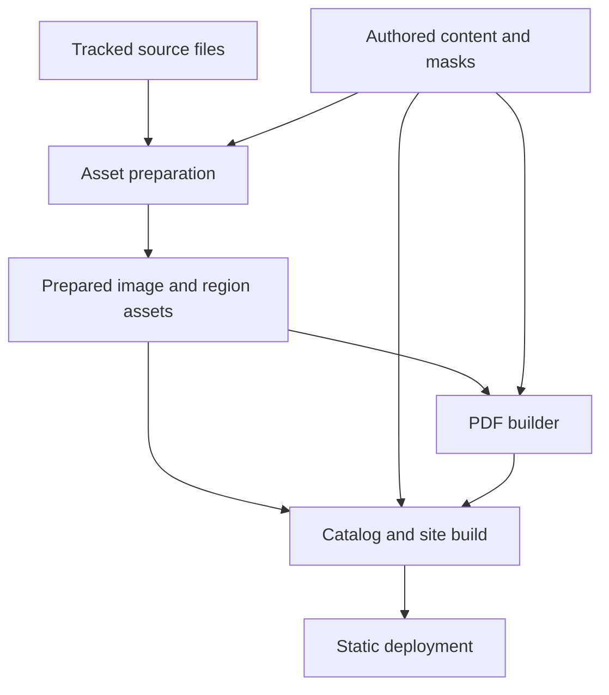
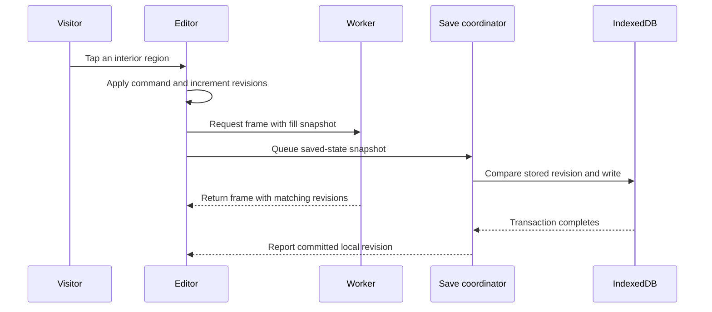

# FCC Stained Glass Software Architecture and Technical Design

## Construction plan and implementation contracts

**Project:** The Stained Glass of First Congregational Church, Kalamazoo.  
**Document:** Technical design version 1.0, 6 November 2026  
**Repository filename:** TECHNICAL_DESIGN.md  
**Companion:** REQUIREMENTS.md version 1.0  
**Implementation status:** This document specifies the system to build. Script names, interfaces, examples, and tests below are construction instructions; they are not a claim that the application or scripts already exist.

Build a public, self-contained project that another person can obtain with an ordinary HTTPS Git clone or GitHub Download ZIP. Include the website code, original project materials, prepared coloring assets, printable files, tests, and instructions. Reading the site, getting the project, installing its public dependencies, running it locally, and rebuilding it must require no application, Google, or GitHub login.

The architecture has three parts: local preparation tools turn the supplied material into reviewed assets; a static build publishes those assets and the interface; the visitor's browser performs coloring, saving, and image export. Historical identification is recorded in the content catalog. It is not an online AI feature. The published application has no backend, API key, login, or dependency on the owner's Drive.

This document makes the implementation choices that a future developer or coding model should otherwise have to guess. It assigns file ownership, defines script and message contracts, explains failure recovery, and gives ordered work packages with completion checks. The requirements remain the authority for visitor behavior. The explicit changes in Section 1 incorporate the owner's newer instruction about a complete public repository.

**Reading guide:** Sections 1–5 define the architecture and data. Sections 6–7 and 12 define the scripts. Sections 8–10 define the browser. Sections 11 and 13 cover downloads and deployment. Sections 14–15 provide the tests and ordered implementation handoff.

## 1 Authority and decisions

### 1.1 Changes to the requirements baseline

The owner's 6 November 2026 instruction is that someone else should be able to clone the repository and get the whole project without logins. Apply the following changes when implementing the version 1.0 requirements. This document records those changes without rewriting the previously delivered requirements file. [R1, R2]

| Earlier provision | Binding design change |
| --- | --- |
| Requirements 6.3 preferred original acquisition files outside the public repository | All source files used by this project are ordinary tracked repository files. Original bytes, prepared assets, editorial records, and regeneration inputs travel together. |
| Requirements 12.2 showed source import in the initial setup sequence | A recipient starts with npm ci and npm run dev. Import is a maintainer operation for initial assembly or later additions. |
| AT26 required a clean build using prepared assets | Also require full regeneration from the source files included in an anonymous clone and source ZIP. |
| Milestone 1 placed all historical pairing reviews before the first working editor | Establish the inventory and review one representative design first. Remaining historical review may proceed alongside implementation. All release reviews still apply. |
| One revision field could be interpreted as both editing order and database version | Separate local state, paint, viewport, and stored revisions as defined in Sections 9 and 10. |
| Review readiness could be edited in both an artwork and a review file | Make content/reviews authoritative; derive public reviewState from a receipt matching the examined input hashes. |

Keep every other agreed behavior: two primary home choices; 55 original-photo records; 48 designs from 002.png through 049.png; plain English; phone portrait use; tap-fill; original-reference toggle; local saving; PNG export; 48 individual PDFs; and the anniversary book. Historical uncertainty remains explicit. [R1]

### 1.2 Additional release requirements

| ID | Complete project requirement |
| --- | --- |
| OPEN01 | Ordinary HTTPS clone and Download ZIP contain all project source files and prepared assets as real bytes. |
| OPEN02 | Preview, validation, build, and regeneration require no project credentials, Drive session, paid service, or AI API. |
| OPEN03 | Runtime assets, libraries, fonts, region data, and PDFs are served from the site itself. |
| OPEN04 | No required Git LFS objects, submodules, absolute external file paths, or private package dependencies. |
| OPEN05 | Source ZIP operation succeeds without a .git directory or installed Git. Git is required only for Git operations. |
| OPEN06 | A different repository name or deployment subpath works without source-code edits. |
| OPEN07 | README provides complete newcomer commands, regeneration commands, and a separate publishing procedure. |
| OPEN08 | Anonymous clone, ZIP setup, source regeneration, and signed-out site use are demonstrated before release. |

The complete package means every input used to make this project. It does not require unrelated Drive folders or unused artwork experiments. The included historical source files are the located transcriptions; label them accurately. Include a source scan later if it becomes an input, without pretending that one has already been found.

### 1.3 Fixed implementation choices

Use Node 24, npm with a committed lockfile, TypeScript, and Vite with vanilla TypeScript. Use sharp for image decoding and web derivatives, fflate for region compression, fast-png for browser PNG encoding, pdf-lib with an embedded local font for PDFs, Zod for runtime JSON validation, tsx for build scripts, Vitest for logic tests, and Playwright for browser tests. Pin the versions actually installed and tested. Include the font's license file. No framework or service is needed beyond this stack. [R1; D03, D05–D10]

Use one canonical Node implementation for each operation. PowerShell scripts are wrappers, not second implementations. Use hash routing. Keep authored content separate from generated metadata. Prepare fill regions before publication. Store coloring as region-to-color assignments. Publish through GitHub Actions to GitHub Pages.

## 2 What a recipient gets and how to start

### 2.1 Included materials

The finished repository must contain the following, all in ordinary tracked files:

| Material | Required contents |
| --- | --- |
| Original photographs | All 55 JPEGs, preserving the supplied bytes and filenames. |
| Final coloring sources | All 48 PNGs, 002.png through 049.png, preserving the supplied bytes. |
| Cover sources | Selected two-building illustration and the approved print-ready cover artwork. |
| Historical sources | Full local text transcriptions of H28 and H35, provenance, and source locators used for the descriptions. |
| Editorial material | Titles, descriptions, locations, matches, confidence, citations, book order, segmentation settings, masks, and review records. |
| Prepared assets | Web images, thumbnails, canonical drawing images, maps, retained released region versions, individual PDFs, and complete book. |
| Construction material | Source code, configuration, lockfile, tests, fixtures, local fonts, scripts, documentation, and source checksums. |

The known 55 JPEG and 48 PNG source inventories total 255,879,700 bytes before cover, fonts, and prepared files. This is the source inventory already measured, not the eventual repository size. Measure the completed repository and site at release. [R1]

### 2.2 Newcomer quickstart contract

The final README must replace the example repository URL with the actual public URL. It must state that Node 24 with npm is the prerequisite; Git is needed for cloning. It must not assume GitHub CLI or require a sign-in command.

```powershell
git clone https://github.com/OWNER/REPOSITORY.git
Set-Location REPOSITORY
npm ci
npm run dev
```

Expected result: the terminal prints the local server address; opening it displays the two-choice home and the supplied collection. The repository's default development script must not trigger source import, image generation, or full release validation. Prepared assets are already included.

For Download ZIP, extract the archive and open a terminal in the directory containing package.json. Run npm ci and npm run dev. This path must work without Git. GitHub source archives contain a snapshot rather than the complete Git history. [D01, D02]

A first npm ci downloads public dependencies and needs an internet connection. It requires no npm account for public packages. After dependencies are installed, local operation and source regeneration use the included project files. The repository does not bundle Node or node_modules; no-login setup is distinct from installation on a disconnected computer. [D03, D04]

### 2.3 Build and regeneration contracts

To verify the prepared project:

```powershell
npm run validate
npm run build
npm run preview
```

To regenerate its images, maps, and printable files from the included inputs:

```powershell
npm run prepare -- --all
npm run pdf
npm run catalog -- --mode release
npm run validate
npm run build
```

These sequences must work in a directory chosen by the recipient, including a path with spaces. Scripts resolve paths from the project root, not a drive letter, username, or the shell's initial working directory. npm commands remain the cross-platform interface. PowerShell wrappers provide equivalent Windows conveniences.

Publishing is a separate maintainer procedure. Authentication for pushing to an owned repository or enabling its Pages deployment is not a prerequisite for obtaining, running, or rebuilding this public project. No publishing credential belongs in the browser bundle or newcomer setup.

## 3 System architecture

### 3.1 Boundaries

| Boundary | Owns | Receives | Produces |
| --- | --- | --- | --- |
| Source and editorial work | Original files, historical assertions, associations, review decisions | Supplied materials and human or AI-assisted review | Tracked source files and content records |
| Preparation tools | Canonical images, regions, derivatives, print composition | Local source and content files | Prepared assets and machine-readable receipts |
| Build and publication | Type checking, public projection, production bundle, deployment | Tracked code and prepared assets | dist and a published static site |
| Browser main thread | Navigation, UI, fills, hit testing, gesture state, save coordination | Public catalog, hit map, user actions | Commands, saved records, display frames |
| Browser worker | Paint map, ink alpha, pixel composition, PNG encoding | Versioned assets and immutable requests | Ready metadata, RGBA frames, PNG bytes |
| IndexedDB | Local saved colorings | Atomic snapshots from the save coordinator | Restored records and commit results |

### 3.2 Preparation and publication flow



Preparation writes generated outputs and receipts. It does not write historical prose or approve its own reviews. The PDF builder uses canonical drawings and authored print text. The site build projects current authored content into public JSON and bundles the browser application. GitHub Actions can build from committed prepared files; source regeneration is a separate verification job.

### 3.3 A coloring operation



Rendering and persistence are independent. Displaying a frame does not mean a save completed. A later edit may supersede a frame, while an export intentionally retains the snapshot captured when it began. Navigation releases the active renderer but does not abandon queued saves.

## 4 Repository layout and ownership

### 4.1 Canonical layout

Use lowercase directory names and stable IDs. Preserve original source filenames inside the source folders. Runtime derivatives use safe ID-based filenames. The following is the target layout; it is not an inventory of code already written.

```text
fcc-stained-glass/
  README.md
  REQUIREMENTS.md
  TECHNICAL_DESIGN.md
  STATUS.md
  DECISIONS.md
  LICENSE
  ASSET_CREDITS.md
  THIRD_PARTY_NOTICES.md
  project.json
  package.json
  package-lock.json
  .nvmrc
  .gitignore
  .gitattributes
  index.html
  vite.config.ts
  tsconfig.json
  tsconfig.app.json
  tsconfig.worker.json
  tsconfig.tools.json
  vitest.config.ts
  playwright.config.ts
  source/
    manifest.json
    photos/
    coloring/
    cover/
    histories/h28.txt
    histories/h35.txt
    fonts/
    archive/<sourceId>/<sourceDigest>/
  content/
    photos.json
    artworks.json
    historical-subjects.json
    sources.json
    media.json
    book.json
    accessibility/<artworkId>/<contentVersion>.json
    segmentation/<artworkId>/config.json
    segmentation/<artworkId>/domain.png
    segmentation/<artworkId>/barrier-add.png
    segmentation/<artworkId>/barrier-remove.png
    reviews/
  generated/
    assets.json
    pdfs.json
    recipes/<artworkId>/<contentVersion>/
  public/
    catalog.json
    catalog.dev.json
    images/photos/
    images/thumbnails/
    art/<artworkId>/<contentVersion>/
    accessibility/<artworkId>/<contentVersion>/<metadataDigest>.json
    downloads/pages/
    downloads/fcc-coloring-book.pdf
    downloads/book-manifest.json
  src/
    main.ts
    router.ts
    config.ts
    styles.css
    shared/contracts.ts
    shared/validation.ts
    shared/coordinates.ts
    data/catalog.ts
    screens/home.ts
    screens/history.ts
    screens/coloring-list.ts
    editor/controller.ts
    editor/reducer.ts
    editor/gestures.ts
    editor/keyboard.ts
    editor/view.ts
    editor/worker-client.ts
    editor/worker.ts
    editor/compositor.ts
    editor/png.ts
    storage/database.ts
    storage/coordinator.ts
  scripts/
    import-sources.ts
    prepare-assets.ts
    build-catalog.ts
    build-pdfs.ts
    validate-content.ts
    build-site.ts
    audit-portability.ts
    package-site.ts
    serve-static.mjs
    lib/paths.ts
    lib/digests.ts
    lib/atomic-files.ts
    lib/segmentation.ts
    lib/algorithms/<algorithmVersion>.ts
    lib/contracts.ts
    Import-Sources.ps1
    Check.ps1
    Preview.ps1
    Publish.ps1
  tests/
    fixtures/
    unit/
    browser/
  .github/workflows/verify.yml
  .github/workflows/pages.yml
  .github/workflows/release.yml
```

Ignore node_modules, dist, dist-portable, .work, test browser output, and generated release ZIPs. Keep source, content, generated registries, and all required public assets tracked. Never use export-ignore on material needed by a source ZIP. Required inputs are regular files inside the project, not symlinks to another location. [D02]

### 4.2 Write boundaries

| Location | Classification | Writer |
| --- | --- | --- |
| source | Acquired canonical inputs | Importer or explicitly documented source update |
| content | Authored canonical decisions | Content editor or reviewed patch |
| content/reviews | Review evidence | Reviewer after examining the named version |
| generated/assets.json and generated/recipes | Generated active/archive registry and immutable regeneration recipes | Asset preparer |
| generated/pdfs.json | Generated print receipts | PDF builder |
| public/art and public/images | Generated runtime assets | Asset preparer |
| public/downloads | Generated print outputs | PDF builder |
| public/catalog.json | Generated release projection | Catalog builder |
| public/catalog.dev.json | Generated development projection | Catalog builder |
| dist and dist-portable | Disposable production output | Site builder |
| STATUS.md and DECISIONS.md | Progress and decision records | Implementer |

No preparation script may invent historical matches, change authored titles, renumber book order, or mark a review complete. A source-content change and a derived-file change must be distinguishable in Git. Generated registries contain hashes and paths, not a second copy of the editable descriptions.

### 4.3 Provenance and credits

Record acquisition URLs and source identities as provenance. They are reference information, never required fetch targets. Include the supplied source transcriptions locally so a recipient can inspect the historical evidence without the owner's Drive account. Preserve historical source labels and distinguish transcriptions from scans.

Provide LICENSE for the software and ASSET_CREDITS.md for photographs, artwork, historical sources, and fonts. Record established credits and license terms per material; do not infer authorship or attach an unsupported blanket ownership statement. Dependency notices belong in THIRD_PARTY_NOTICES.md. This documentation is part of the public project package.

## 5 Configuration and data contracts

### 5.1 Project configuration

project.json is tracked and available even when .git is absent. It contains siteId, title, projectVersion, repositoryUrl, defaultBranch, releaseDateUtc, and optional customDomain. releaseDateUtc is a fixed ISO-8601 UTC instant recorded for the release. Default siteId is fcc-kalamazoo-stained-glass. The version is a deliberate release value, not a timestamp generated during every build. repositoryUrl may be null during initial development; release requires the actual public HTTPS repository URL.

Resolve published repository identity from the current GitHub Actions context first and project.json second. This makes fork deployments point to their own source repository. Resolve SITE_BASE as described in Section 13. A source ZIP must never need a Git command to obtain its version, title, or build settings.

### 5.2 Source manifest

Each acquired source file, including preserved archived source bytes, has one manifest record. Count the expected 55 photos and 48 designs by their active stable IDs; archived-source entries do not inflate those collection counts. Use project-relative POSIX-style paths in JSON; convert separators through path helpers for local filesystem access. Resolve paths against the root and reject traversal outside it. Source URLs are optional provenance strings. Hash the actual bytes, not filenames.

```ts
interface SourceEntry {
  id: string;
  role: 'photo' | 'coloring' | 'cover' | 'history' | 'font';
  path: string;
  originalFilename: string;
  bytes: number;
  sha256: string;
  width?: number;
  height?: number;
  provenance: {
    sourceId: string;
    referenceUrl?: string;
    form: 'original-file' | 'transcription' | 'prepared-art';
  };
}
```

The source manifest has schemaVersion: 1 and files: SourceEntry[]. The inventory must contain photo-001 through photo-055 and design-002 through design-049, plus the selected cover, two histories, and fonts. Dimensions describe the measured file; preparation records oriented canonical dimensions separately. Verify all source hashes during source-integrity and release checks. The importer uses the exact source associations from Requirements Appendix A; it does not equate those filenames with the books' numbered subjects. [R1]

### 5.3 Authored records

Use the confidence and evidence contracts from Requirements Section 6. Keep subject identification, location, and media pairing independent. The authoring artwork record contains id, sourceId, bookNumber, title, publicDescription, subjects, location, originalPhoto, and citations. The prepared region package and PDF paths are joined from generated registries, not written into that authored record.

This refinement prevents image preparation from overwriting editorial work. A single photo may relate to several designs, and a design may depict several historical subjects. The public catalog derives reverse links; do not maintain two independently editable copies of the same relationship.

The following is an initial authoring example. It does not assert a completed photo or historical match:

```json
{
  "id": "design-002",
  "sourceId": "design-002",
  "bookNumber": 1,
  "title": "Stained glass design 1",
  "publicDescription": "We are still identifying this picture.",
  "originalPhoto": {
    "value": "photo-002",
    "confidence": "unidentified",
    "rationale": "Same-number filename candidate only.",
    "evidence": []
  },
  "subjects": {
    "value": null,
    "confidence": "unidentified",
    "rationale": "Visual identification has not been reviewed.",
    "evidence": []
  },
  "location": {
    "value": null,
    "confidence": "unidentified",
    "rationale": "Location has not been established.",
    "evidence": []
  },
  "citations": []
}
```

A completed review may still conclude unidentified. Release requires completion of the review, not a fabricated identification. Show original and About this window require a reviewed confirmed or likely photo association that points to a published photo record. Otherwise show Original photo not yet identified and keep coloring usable.

content/reviews is the authority for review completion. Do not duplicate an editable reviewState in authored records. The catalog derives it from a matching receipt. Each receipt contains schemaVersion, recordId, reviewKind (photo-pairing, subject, location, or segmentation), reviewedDigest, reviewer, reviewedAtUtc, and outcome: complete. reviewedDigest covers the relevant assertion plus the exact photo, drawing, and historical-source hashes examined. A changed relevant input invalidates completion even when its stable ID is unchanged. A segmentation receipt binds its contentVersion and the keyboard metadata digest. Pending means no current complete receipt; preparation never creates one.

### 5.4 Generated registry and public projection

generated/assets.json contains schemaVersion and a record per artwork. Each artwork record contains activeVersion and a versions map keyed by contentVersion. Each version carries its own sourceDigest, preparationDigest, and output receipt. Keep released previous versions while they may have saved colorings. The region package is stored under `public/art/<artworkId>/<contentVersion>/package.json.`

The public catalog joins authored records, prepared assets, and PDF receipts. It includes display text, source citation text, confidence labels, web paths, archive-version metadata, and book download information. It excludes acquisition URLs, local filenames that are not needed by visitors, reviewer notes, and machine working paths. Historical source citations remain readable without opening another service.

In development, the catalog also carries ready or unavailable status for not-yet-prepared designs. A card without assets explains that it is not ready in this development build. Release projection contains no development placeholders and requires all 48 designs.

Use these exact registry shapes as the starting contract. Artifact IDs and SHA-256 strings are validated branded strings in implementation. A FileReceipt path here is project-relative, including public/ for generated deliverables. The public projection strips that prefix. Version-specific digests live inside the version record, not once beside all versions.

```ts
interface FileReceipt {
  path: string;
  bytes: number;
  sha256: string;
}

interface PreparedVersion {
  contentVersion: string;
  sourceId: string;
  sourceDigest: string;
  preparationDigest: string;
  package: FileReceipt;
  archiveRecipe?: string;
}

interface PhotoDerivative {
  sourceDigest: string;
  preparationDigest: string;
  web: FileReceipt;
  thumbnail: FileReceipt;
  width: number;
  height: number;
}

interface AssetRegistry {
  schemaVersion: 1;
  artworks: Record<string, {
    activeVersion: string;
    versions: Record<string, PreparedVersion>;
  }>;
  photos: Record<string, PhotoDerivative>;
}
```

Put photo/web/thumbnail sizing and encoder options in content/media.json. Start with a maximum 2000-pixel long edge for photo web images and 320 pixels for thumbnails, preserving aspect ratio without enlargement. Keep full-resolution originals in source/photos. The source digest hashes source bytes; the preparation digest hashes source digest, oriented processing settings, algorithm/encoder version, and output policy. Changing a photo-processing option makes its derivative stale even if its source is unchanged.

Keyboard names and navigation order are authored in `content/accessibility/<artworkId>/<contentVersion>.json` as schemaVersion, artworkId, contentVersion, and regions: [{id, name, order}]. Seed and geometry come from generated regions.json. The catalog builder emits validated `public/accessibility/<artworkId>/<contentVersion>/<metadataDigest>.json` and references its path/hash in the version's public record. This keeps names editable without mutating immutable region packages. The worker's resolved load input includes this accessibility URL and hash. Development may use explicit draft Area 1-style names; release requires complete reviewed names and exactly one entry per positive ID.

### 5.5 Digests and review identity

Use SHA-256, lowercase hexadecimal, and canonical UTF-8 JSON with object keys sorted recursively. Preserve array order when order is meaningful. For composite digests, serialize a typed object containing scalar parameters and hashes of byte inputs; do not concatenate ambiguous raw strings.

Distinguish sourceDigest, preparationDigest, contentVersion, editorialDigest, and printInputDigest. Source or segmentation changes may change region identity. Caption, book order, credit, and review-note changes do not. A review record identifies its design and the exact contentVersion or editorialDigest examined; its timestamp is evidence, not input to deterministic asset identity.

A synthetic fixture may use a made-up ID and explicit fixture data. Real release manifests must not contain placeholder hashes, invented measured dimensions, or example source matches.

## 6 Preparation pipeline

### 6.1 Normalization

Decode a source coloring PNG with the locked sharp version, auto-orient once, convert to 8-bit sRGB RGBA, and obtain native oriented width and height. Flatten each channel C with alpha A onto white as floor((C*A + 255*(255-A) + 127)/255). Then compute grayscale G = floor((77*R + 150*Gchannel + 29*B + 128)/256), using the flattened channels. These coefficients sum to 256, so already-gray opaque pixels stay unchanged. Name this normalization algorithm gray-v1 and test its rounding. Do not also call a library grayscale/flatten operation, which could apply a different formula twice.

Canonical grayscale bytes are one unsigned byte per pixel in row-major order, top to bottom and left to right, with no stride padding. Encode canonical.png as an opaque grayscale PNG from those bytes. Content identity uses decoded pixel bytes; PNG compression/container metadata is not the canonical pixel identity.

Measure width and height from the output pixels. Build every map in that coordinate system. Preserve the supplied source file. Generate web photo derivatives separately, preserving their visual color and full composition. Photo processing never determines the coloring image's geometry.

### 6.2 Segmentation configuration

Each `content/segmentation/<artworkId>/config.json` contains schemaVersion, algorithmVersion, inkThreshold, optional domainMask, optional barrierAddMask, optional barrierRemoveMask, excludedSeedPoints, and notes. Mask paths are relative to that configuration directory. All masks must match canonical dimensions.

Use binary mask pixels: 255 means selected and 0 means unselected. Reject intermediate gray values. In a domain mask, selected pixels are eligible for coloring. In an add mask, selected pixels force a barrier; in a remove mask, selected pixels force nonbarrier status. Reject a pixel selected by both correction masks. These masks change segmentation, not the visible source linework.

Accept an 8-bit grayscale mask, or RGB/RGBA whose RGB channels are equal at every pixel and whose alpha is fully opaque. Normalize it to a single row-major byte channel. Reject unequal channels, partial transparency, wrong dimensions, and nonbinary values. Hash decoded mask bytes rather than PNG container bytes. Missing domain means all 255; missing add/remove masks means all 0. Normalize excludedSeedPoints to integer [x,y] coordinates, reject out-of-range values, deduplicate them, and sort by y then x before processing and effective hashing.

Default inkThreshold is 180 as a starting value to inspect. A missing domain mask allows the whole image before explicit component exclusions. Do not automatically delete all components touching the outer edge or all small components. The review must decide which spaces are intended to be colored.

### 6.3 Exact processing order

1. Normalize the source and retain the canonical grayscale bytes.
2. Set barrier[i] when grayscale[i] is at or below inkThreshold.
3. Apply barrier-add and barrier-remove masks after checking for overlap.
4. Label four-connected nonbarrier components inside the allowed domain.
5. Resolve excluded seed coordinates against those components. Reject a seed outside the allowed nonbarrier area. Exclude each selected component.
6. Assign contiguous positive IDs 1..N to retained components by the row-major index of their first pixel. Reserve 0 for nonpaintable pixels; reject a zero-region result.
7. Write hitLabels and per-region metadata: id; seed [x,y] at the first row-major pixel; pixelCount; bbox {x,y,width,height} with inclusive minimum and exclusive maximum edges; and centroid measured from pixel centers.
8. Generate paintLabels by the deterministic propagation below.
9. Set inkAlpha[i] to 255 minus canonical grayscale[i].
10. Validate the package, write review images, and stage the versioned outputs.

Applying the domain before labeling prevents disconnected remnants from accidentally sharing one ID. Keep the separate barrier and domain masks throughout preprocessing; hit label 0 alone cannot distinguish ink from background.

### 6.4 Paint ownership beneath ink

Seed every nonbarrier pixel in row-major order before propagation begins. A retained interior supplies its region ID; excluded nonbarrier background supplies 0. Barrier pixels begin unvisited. Use a FIFO queue and inspect neighbors in the fixed order up, left, right, down. Mark pixels visited when enqueued; each unvisited neighbor inherits its predecessor's owner. This chooses the nearest seed by Manhattan distance, breaking ties by the initial seed's row-major order.

After propagation, force pixels outside the allowed domain and inside explicit excluded areas to paint owner 0. Keep hitLabels unchanged. This extends fill color under antialiased ink while preserving predictable tapping. An invisible barrier correction can create a sharp boundary in an open-looking gap, so examine the review result.

For each RGB channel, output round(fillChannel * (255 - inkAlpha) / 255). Use white for unfilled regions and owner 0, and output alpha 255. An entirely unfilled result must exactly reproduce the canonical grayscale image. A tap on hit label 0 performs no action.

### 6.5 Region package files

| Filename inside a version directory | Format and purpose |
| --- | --- |
| canonical.png | Normalized grayscale artwork for fallback viewing and printing |
| hit.bin | Gzip-compressed unsigned 32-bit little-endian region IDs for hit testing |
| paint.bin | Gzip-compressed unsigned 32-bit little-endian paint ownership |
| ink.bin | Gzip-compressed unsigned bytes of ink alpha |
| regions.json | Positive region IDs with navigation and geometry metadata |
| package.json | Dimensions, region count, version, paths, byte lengths, and hashes |

The .bin files contain gzip data by explicit package encoding. A .bin suffix avoids relying on a server's treatment of precompressed .gz files. Fetch the stored bytes, validate their compressed hash, then decompress and validate raw length and raw hash. Label maps require 4*width*height bytes each; ink requires width*height. Decode little-endian values correctly. Browser transport compression is separate from this stored format.

Set a fixed gzip timestamp. Define contentVersion from effective scalar parameters, canonical pixels, mask contents, algorithm version, raw labels, and ink bytes. Exclude notes, filenames, filesystem paths, captions, and dates. Store both compressedSha256 and rawSha256 for each binary. The package's own filename and review metadata are not inputs to the region version.

```ts
interface RegionBinary {
  path: string;
  encoding: 'gzip-u32le' | 'gzip-u8';
  compressedBytes: number;
  compressedSha256: string;
  uncompressedBytes: number;
  rawSha256: string;
}

interface RegionPackage {
  schemaVersion: 1;
  algorithmVersion: string;
  artworkId: string;
  contentVersion: string;
  width: number;
  height: number;
  regionCount: number;
  canonical: FileReceipt;
  regions: FileReceipt;
  hitLabels: RegionBinary;
  paintLabels: RegionBinary;
  inkAlpha: RegionBinary;
}
```

Paths inside RegionPackage are relative to package.json's directory, for example hit.bin and canonical.png; they must stay within it. The registry holds the package file's own path/hash. regions.json contains schemaVersion and a regions array of the geometric records from step 7, ordered by ID. Validate integer dimensions, overflow-safe expected byte counts, contiguous region IDs, finite geometric values, and package/registry agreement before use. An ink entry uses gzip-u8; both label entries use gzip-u32le. Set gzip mtime to 0.

When each content version is first prepared, freeze its regeneration recipe under `generated/recipes/<artworkId>/<contentVersion>/.` Include canonical grayscale input, effective segmentation settings, decoded masks, normalized exclusions, expected hashes, and algorithmVersion before any later edit can change them. These committed recipe inputs are retained even if other generated outputs are deleted. Keep the corresponding segmentation algorithm implementation in scripts/lib/algorithms. archiveRecipe points to that recipe. The importer preserves original source bytes and their manifest receipt under `source/archive/<sourceId>/<sourceDigest>/` before any later replacement. prepare --all --include-archives regenerates retained versions from their frozen recipes and verifies expected contentVersion; failure is explicit, never a silent migration. Normal prepare --all processes current designs and retains archived outputs. PT04 uses --include-archives when archives exist.

Review images live under `.work/review/<artworkId>/<contentVersion>/` and are reproducible. Store a compact review record under content/reviews after inspection. Do not bulk-commit large temporary contact sheets merely because a script produced them. The canonical inputs and accepted output packages remain committed.

## 7 Script contracts

### 7.1 Common rules

Resolve the repository root from the script's own location. Use shared path, schema, hashing, and atomic-write helpers. Parse arguments explicitly; unknown flags are errors. Every script prints a concise human result and writes a JSON run report under .work/reports. Reports contain operation, scope, inputs, outputs, digests, warnings, and stable error codes. Do not write credentials or entire environment variables into reports.

Exit codes are 0 success, 2 invalid command or prerequisite, 3 invalid input/schema/hash, 4 stale or incomplete prepared material, 5 processing or filesystem failure, and 6 deployment/packaging or portability failure. A validation report can collect multiple errors before returning its nonzero code; processing tools stop when continuing could invalidate their active manifest.

Write generated outputs to a fresh .work/staging directory, verify them, then promote them. For a preparation batch, the active asset registry changes only after every requested design succeeds. A failure leaves previous active references intact. Immutable content-version directories may be installed before the registry swap; an unreferenced new directory is harmless and must not replace an older version. Use a same-directory temporary file and a tested atomic replacement helper for manifests. A failed replacement must preserve the last valid manifest.

An unchanged rerun must preserve contentVersion and prepared raw bytes. It must not reset review status or rewrite source files. Version deletion is a separate explicit maintenance action, never a side effect of prepare --all. Keep released archive versions referenced by saved-state compatibility rules.

### 7.2 Command ownership

| npm command | Canonical implementation | Default scope |
| --- | --- | --- |
| import | scripts/import-sources.ts | Explicit acquisition source argument |
| prepare | scripts/prepare-assets.ts | --id or --all processes assets; no arguments is a no-op |
| catalog | scripts/build-catalog.ts | Development unless --mode release |
| pdf | scripts/build-pdfs.ts | Complete print set; --id selects one sheet |
| validate | scripts/validate-content.ts | Complete release validation |
| audit:portable | scripts/audit-portability.ts | Entire project and optional dist |
| dev | Development catalog build, then Vite | Allows unfinished designs |
| build | scripts/build-site.ts | Release validation and production build |
| preview | scripts/serve-static.mjs | Serve existing dist locally |
| package:site | scripts/package-site.ts | Verified relative-base site ZIP |
| test | Vitest | Unit and deterministic data tests |
| test:e2e | Playwright | Browser workflows |

Use tsx to execute the .ts scripts. Keep orchestration in the Node script rather than a platform-specific shell chain. main npm commands must work in PowerShell, cmd, and a Unix shell. package.json records the exact invocation for every row.

### 7.3 Import sources

Command: npm run import -- --source-root PATH. The acquisition path is the owner's Coloring Book parent. An optional --history-root PATH and --cover-file PATH supply the initial source texts and selected cover. After initial assembly, a maintainer may use --replace-source ID with an explicit matching replacement input. A new ordinary clone does not run this command.

Read source bytes, validate expected names and types, calculate hashes and dimensions, then copy them into source. Write source/manifest.json after the entire requested import validates. Before replacing existing bytes, preserve them and their receipt in source/archive; add `archived-source-<sha256>` manifest entries separately from the 55 active photo and 48 active design IDs. Create a proposed inventory report for additions. Do not overwrite an existing different source ID silently, infer historical subjects, or rewrite authored descriptions. A changed source makes dependent prepared receipts stale; downstream validation reports that fact.

### 7.4 Prepare assets

Command: npm run prepare -- --id design-002 or npm run prepare -- --all. With --id, process the selected design and any missing or stale derivative for its reviewed associated photograph. With --all, process all drawings and all 55 photo derivatives. Inputs are source/manifest.json, the relevant source bytes, authored photo associations, content/media.json derivative settings, and content/segmentation configurations.

Outputs are version directories, photo/thumbnail derivatives, review images, and generated/assets.json. Record canonical dimensions and hashes from actual output. A new version preserves earlier released versions. A matching existing version is reused only after verifying its hashes. Do not accept a directory's name as evidence that its contents are valid.

Completion check: validate --stage assets --id design-002 succeeds for a selected run. The report identifies the resulting contentVersion and review-image directory. Processing success leaves segmentation review pending until a reviewer examines that version.

### 7.5 Build the catalog

Command: npm run catalog -- --mode development or --mode release. Join authored records, the source manifest, prepared registries, review records, and printable receipts. Validate relationships and generate reverse links. Development writes public/catalog.dev.json and represents unavailable designs explicitly. Release writes public/catalog.json and requires the full collection.

Read historical content only from the authored catalog. Do not derive a historical subject or photo route from a filename number. Format source citations from content/sources.json and evidence locators. Copy only public fields. Catalog output changes after an editorial correction; unchanged coloring maps remain unchanged.

### 7.6 Build printable files

Command: npm run pdf -- --id design-002 creates one individual sheet. npm run pdf creates every individual sheet, the book, and its page manifest. Inputs are canonical images, content/book.json, authored titles and locations, approved cover, local font files, and source/credit text.

Write individual PDFs to public/downloads/pages/design-002.pdf and equivalent stable paths. Write the complete book to public/downloads/fcc-coloring-book.pdf. Record output hashes and printInputDigest in generated/pdfs.json. Include all relevant art, print text, order, fonts, layout version, cover, introduction, and sources in the appropriate digest. Set PDF creation and modification metadata dates from project.json releaseDateUtc so an unchanged rebuild does not create time-only differences.

The print registry has schemaVersion: 1, pages as a partial map keyed by artworkId, and book as null or a book receipt. A selected-sheet development run may populate one page and leave book null; release validation requires all 48 pages and a non-null book. Each page value is {file: FileReceipt, printInputDigest, layoutVersion}. A non-null book value has those fields plus manifest: FileReceipt. All paths are project-relative. Include releaseDateUtc in each printInputDigest because it affects output metadata. Build the book from validated interior page objects/files and record its manifest only after assembly determines actual page positions.

Stage and validate the whole requested print batch before promoting files and its registry. A failed build must leave prior valid downloads available and mark the requested build failed. Existing but stale PDFs fail release validation. A text-only edit requires the affected PDF and catalog regeneration, not region preparation.

### 7.7 Validate content

Command: npm run validate defaults to --stage release. Catalog validation checks all 55/48 inventory entries, unique IDs, book order, source bytes and hashes, editorial schemas, and cross-references. It allows pending preparation and review. Assets validation adds output bytes, dimensions, map hashes/ranges, metadata coverage, and freshness. It accepts --id for a selected design without demanding the remaining packages.

Release validation requires all source materials, all 48 active packages, all required completed reviews, every print output, current print receipts, public catalog consistency, and a complete book manifest. Unidentified historical outcomes may pass when their review is complete and wording is honest. Missing segmentation review or a failed fill region does not pass.

An error must name the file, record, field, and corrective command where possible. Example:

```text
E_PDF_STALE design-002
public/downloads/pages/design-002.pdf
The title changed after this sheet was generated.
Run: npm run pdf -- --id design-002
```

### 7.8 Build the site and packages

build-site.ts type-checks the project, regenerates release catalog JSON, validates release inputs, and invokes Vite with the resolved base. It writes a build receipt containing project version, base, repository URL, catalog digest, and deployment file inventory. It never invokes Drive import or an AI service.

audit-portability.ts checks required source and runtime paths, hashes, missing tracked files, LFS pointer signatures, submodule requirements, external absolute paths, prohibited runtime origins, and size limits. When .git is absent, use the source and release inventories rather than failing a Git command. See Section 14 for the actual anonymous-clone verification.

package-site.ts invokes the same validated build with base ./ and a separate dist-portable directory. It tests that output under a non-root HTTP path, includes a small static-server script and instructions, and creates a ZIP under .work/releases. This portable site ZIP contains built runtime files. The full source repository or source ZIP contains all project materials. Neither package is described as the other.

### 7.9 PowerShell wrappers

Import-Sources.ps1 forwards its validated path arguments to npm run import -- followed by an argument array. Check.ps1 checks Git only when requested, checks Node/npm, then invokes the chosen validation and tests. Preview.ps1 starts development by default and accepts -Built to serve dist. Publish.ps1 verifies the intended repository and branch, runs release checks, commits only explicitly selected project changes when requested, and pushes normally.

Use $PSScriptRoot to locate the project and preserve the caller's working directory on exit. Pass arguments as arrays, not constructed command strings. Propagate the Node command's exit code. Do not initialize repositories, rewrite remotes, force-push, or discard unrelated work as an automatic repair. Keep the publishing procedure separate from preview.

## 8 Browser modules and interfaces

### 8.1 Module ownership

| Module | Responsibility | Must not own |
| --- | --- | --- |
| main.ts and router.ts | Start the app, resolve hash routes, dispose old screens, preserve application services | Pixel algorithms or database transactions |
| config.ts and data/catalog.ts | Resolve local asset URLs, fetch and validate the catalog | Historical inference or map generation |
| screens | Home, original-photo history, coloring list, visible navigation | Direct mutation of editor state |
| editor/controller.ts | One editing session, readiness gates, state transitions, coordination | Duplicated storage or segmentation algorithms |
| editor/reducer.ts | Pure fill, undo, redo, and reset logic | DOM, workers, fetch, storage |
| editor/gestures.ts | Pointer state machine and viewport changes | Applying color before an eligible pointer-up |
| editor/keyboard.ts | Reachable region navigation and discrete commands | A separate implementation of painting |
| editor/view.ts | DOM controls, accessible messages, frame display, reference view | Authoritative fill state |
| editor/worker-client.ts | Session IDs, request IDs, render queue, reply validation | Persistent storage |
| editor/worker.ts | Load maps, verify bytes, receive requests, transfer results | DOM or IndexedDB |
| editor/compositor.ts and png.ts | Pixel composition and PNG encoding | Current UI/reference state |
| storage/database.ts | Database schemas, reads, atomic conditional commits | UI messages or render revisions |
| storage/coordinator.ts | Per-key save queues and unsaved-state cache | Large image buffers |

Keep shared runtime types and schemas under src/shared. Script-specific manifest schemas may extend those contracts in scripts/lib/contracts.ts. Shared modules must have no DOM or Node side effects so both the browser and tools can import them. Use separate TypeScript configurations for browser, worker, and Node code; enforce strict checking. This prevents a Node dependency from silently entering the browser bundle.

### 8.2 Public editor interface

```ts
interface EditorSession {
  dispatch(command: EditorCommand): void;
  setReferenceVisible(visible: boolean): void;
  setViewport(viewport: Viewport): void;
  prepareDownload(): Promise<PreparedDownload>;
  dispose(): void;
}

function openEditor(
  artworkId: ArtworkId,
  host: HTMLElement,
  options: { signal: AbortSignal; contentVersion?: string }
): Promise<EditorSession>;

interface PreparedDownload {
  blob: Blob;
  filename: string;
  capturedPaintRevision: number;
}

type EditorCommand =
  | { kind: 'fill'; regionId: number }
  | { kind: 'select-color'; color: string }
  | { kind: 'undo' }
  | { kind: 'redo' }
  | { kind: 'reset-confirmed' };
```

Validate the color as #RRGGBB. The controller supplies the selected color to the pure reducer and computes before/after history; views must not construct stored undo diffs themselves. reset-confirmed is dispatched only after the visitor accepts the Start over confirmation.

The controller accepts both touch and keyboard commands through the same dispatch guard. A fill is allowed only when the package is validated, restoration is resolved, and the original-reference view is hidden. Invalid region IDs, region 0, and out-of-bounds coordinates do nothing. Programmatic commands cannot bypass these checks.

The router creates an AbortController before calling openEditor and aborts it on navigation, including while openEditor is unresolved. The editor checks the signal after each asynchronous boundary, aborts its fetches, terminates its worker, removes partial UI/listeners, and rejects with a handled AbortError. openEditor creates a new session token, selects the active or explicitly restored archived content version, loads its package, and obtains saved or cached state. Show the drawing and loading status while the maps load. Enable painting only after both map loading and restoration finish. A failure leaves the drawing, navigation, and PDF download usable. Retry replaces the failed session and ignores its late replies.

### 8.3 Routes and screens

| Route | Screen and behavior |
| --- | --- |
| #/ | Home with exactly two primary choices: About the stained glass and Coloring pages |
| #/about | Original-photo collection and short church/context introduction |
| #/about/photo-002 | Original photograph, readable description, location or uncertainty, evidence, related designs |
| #/coloring | 48 design cards, individual PDF access, and complete-book download |
| #/coloring/design-002 | Editor and associated history/PDF links |

Treat these routes as stable interfaces. Resolve unknown IDs to a helpful screen with a return link, not a broken editor. Back, Forward, direct links, and reload must work. The source-repository link belongs within the About and Coloring sections; it is not a third primary home destination.

Gallery cards fetch thumbnails. Opening a history page fetches that photo's web image. Opening an editor fetches only its own full package. Do not prefetch all region maps or the book. Use normal text elements for descriptions and citations; long history text must remain selectable and readable with enlarged text.

## 9 Coloring, rendering, and export

### 9.1 State and revision counters

Store actual uppercase #RRGGBB values keyed by region ID. An absent assignment means uncolored; explicit white is a real color. Keep selectedColor, fills, undoStack, redoStack, reference visibility, and the coloring viewport in session state. Persist the fields required by Requirements Section 10; transient loading and reference visibility are not save success indicators.

| Counter | Changes when | Purpose |
| --- | --- | --- |
| localStateRevision | Any persisted field changes | Identify the latest snapshot that must be saved |
| paintRevision | Fills change through paint, undo, redo, or reset | Reject stale pixel frames and identify export snapshots |
| viewportRevision | Stage geometry, zoom, pan, or backing dimensions change | Reject frames for an old view |
| storedRevision | A database conditional commit completes | Detect conflicting writes from other tabs |

These are distinct counters. Palette selection can require saving without repainting the drawing. A saving-status update changes none of them. A reset changes paint and local revisions. Viewport changes repaint; if the viewport is persisted, they also change localStateRevision. Use integers that increase within their defined scope; do not use wall-clock timestamps for ordering.

The pure reducer returns the new state and whether a meaningful change occurred. Paint to an existing value is a no-op. Record each fill as regionId, before, and after. A confirmed Start over is one batch containing only previously filled regions. Undo restores the batch; redo reapplies it. Keep the most recent 100 meaningful commands. A new fill after undo clears redo. Palette changes and camera movement do not enter coloring history. [R1]

### 9.2 Coordinates and gestures

```ts
interface Viewport {
  cssWidth: number;
  cssHeight: number;
  pixelWidth: number;
  pixelHeight: number;
  scale: number;
  translateX: number;
  translateY: number;
}
```

scale converts canonical image pixels into CSS pixels. translateX and translateY are CSS-pixel offsets from the stage's top-left. Compute fit scale as min(stageWidth/imageWidth, stageHeight/imageHeight); relative zoom starts at 1 and is limited to 1–8. Center the fitted image and add pan offsets. Keep the image reachable after resizing and provide a Fit button. Pinch and button zoom preserve the canonical point under the gesture center or stage center.

Defer rendering while CSS dimensions or backing dimensions are zero/nonfinite, or scale is nonpositive/nonfinite. Persist a SavedView with zoomRelativeToFit, centerXNormalized, and centerYNormalized. Reconstruct the live viewport from these normalized values and the current stage; do not restore a previous phone's pixel dimensions or absolute translations. Clamp the reconstructed view to the reachable image.

For a pointer, subtract the current stage bounding rectangle from clientX/clientY, then apply the inverse translation and scale. Floor the resulting image coordinates and reject coordinates outside the image before reading hitLabels. Never multiply the pointer coordinates by devicePixelRatio.

For worker output pixel (px, py), first obtain CSS coordinates as (px + 0.5) × cssWidth / pixelWidth and (py + 0.5) × cssHeight / pixelHeight, then apply the same inverse transform. This handles rounded canvas dimensions. Put these calculations in shared/coordinates.ts and test that rendering and hit testing agree.

Keep Pointer Events states idle, pendingTap, pan, and pinch. Movement over 8 CSS pixels cancels the tap and starts pan. A second pointer cancels painting until all pointers are lifted; lifting one pinch finger must not rearm a tap. Capture pointers. On cancellation, lost capture, or navigation, end the gesture with no paint. Only an eligible single-pointer release dispatches fill. Primary mouse input uses the same path; do not add a duplicate click-to-paint handler. Apply touch-action: none only to the drawing stage. [R1; D12]

### 9.3 Worker message contract

Every request and response contains this envelope:

```ts
interface Envelope {
  sessionId: number;
  requestId: number;
  artworkId: ArtworkId;
  contentVersion: string;
}
```

| Request | Required payload | Response |
| --- | --- | --- |
| load | Resolved package with local URLs, sizes, and expected hashes | ready: width, height, region metadata, transferred hit-label buffer |
| render | Immutable fill snapshot, viewport, paintRevision, viewportRevision | frame: RGBA buffer, pixel width/height, matching revisions |
| export | Immutable fill snapshot and captured paintRevision | exported: native-size PNG bytes and captured revision |
| Any failed request | Originating envelope | error: operation, stable errorCode, readable message |

The worker verifies compressed and decompressed bytes before returning ready. Transfer hitLabels once to the main thread and stop reading it in the worker. Keep paintLabels and inkAlpha in the worker. Transfer newly produced frame/PNG buffers, never the live map buffers. ArrayBuffer transfer detaches the sender's buffer. [D13]

worker-client resolves catalog paths against the application base, and package-member paths against the package URL, before sending absolute URLs to the worker. Never resolve those resources relative to the worker bundle. ready includes validated geometric and keyboard metadata. A frame is already in viewport coordinates; display its RGBA pixels at (0,0) without applying the pan/zoom transform a second time.

A render request is self-contained; it carries the current small fill snapshot. Do not add a separate asynchronous update-colors protocol. Main-thread worker-client permits one render request in flight and one replaceable latest desired request. When the in-flight request finishes, send the latest pending one. This is real coalescing: a busy worker executing a synchronous pixel loop cannot process a cancellation message in that loop.

Accept a frame only if its session, artwork, content version, paint revision, and viewport revision match the current desired view. Ignore stale replies. A failed render clears the in-flight slot and reports a retryable error; it must not stall the queue permanently. Terminate the worker on editor disposal and reject outstanding promises with a handled session-ended result.

### 9.4 Pixel composition and memory

Use one viewport-sized display canvas, with backing dimensions based on a device-pixel ratio capped at 2. Zoom never creates a canvas eight times the drawing's size. For the initial implementation, the worker builds a native RGBA composition when paintRevision changes and reuses it for viewport changes. This costs 4 × width × height bytes beyond the maps, with one active design only.

The native cache starts invalid. Its key includes sessionId, contentVersion, and paintRevision; the first render or export composes the requested fills even when its revision is 0. Reload saved version starts a new session or advances paintRevision when it replaces fills.

At each native pixel, choose white for owner 0 or an unfilled region; otherwise choose its assigned color. For each RGB channel use round(fillChannel × (255 − inkAlpha) / 255). Set alpha to 255. With every region unfilled, this must reproduce the canonical grayscale exactly. Black ink remains black and antialiased edges receive the adjacent fill beneath them. [R1]

When the image is reduced, area-average the already composited RGB pixels into display pixels so thin lines remain visible. At native size or larger, use nearest-neighbor sampling. Never interpolate region IDs. The typed-RGBA path is the required fallback and must work without OffscreenCanvas. Release previous frames, native caches, and maps when their session ends. Measure the largest actual design before introducing a more complicated renderer.

PNG encoding uses a captured fill snapshot. It may reuse native composition only when its revision matches that snapshot. Otherwise generate a separate native composition for the export. One export at a time bounds memory. A synchronous encoder can delay subsequent worker frames; controls and main-thread input remain responsive and the pending-render queue retains the latest state. [D08, D13]

### 9.5 Reference view, keyboard, and portrait layout

Show original changes visibility only. Fit the photo using its own proportions; it is not assumed to align with generated line art. Keep the coloring viewport and all edits. Hide original returns to that view. A failed photograph request offers Retry while coloring remains intact. Export always uses the colored drawing.

On portrait phones, put a short title and Back link above the stage; keep named color buttons and essential actions immediately below it. Use wrapping groups and normal page scrolling outside the stage. Do not put every control in a fixed-height screen that clips at 320 CSS pixels or enlarged text. Use visible labels such as Undo, Redo, Start over, Fit, Show original, and Download my picture. Maintain target size, contrast, focus, and text requirements from the requirements document. [R1]

Each positive region ID must have reviewed keyboard metadata: an accessible name, seed point, and navigation order. Previous region and Next region move the selection; selecting a named color and activating Fill selected area dispatches the same fill command as touch. A visible outline identifies the selected region without becoming part of PNG output. Announce the selected area and meaningful fill/undo results. Focus must be able to leave the stage normally. This provides complete discrete coloring without requiring a sighted mouse gesture.

Within the focused stage, Left/Up selects the previous region, Right/Down selects the next, Home/End selects the first/last, and Enter/Space fills the selected region. Tab leaves the stage normally. Button equivalents remain visible for users who do not know these keys.

### 9.6 Download lifecycle

Download my picture captures the current fills and paintRevision, then shows Preparing picture…. Match the export reply to its original request and session. Later fills or reset do not invalidate that deliberate snapshot. Once encoded, create a Blob and show a real Save image action for a fresh user tap; also provide Open image when the browser needs that saving route. Use fcc-design-002-colored.png as the filename pattern.

Retain the Blob URL while the saving action is available. Revoke it when replaced or when its view is disposed. Do not assume a long asynchronous operation preserves browser user activation. Export failures keep state and allow Retry. Verify the image's native dimensions, opaque alpha, full extent, and absence of UI or reference pixels. [R1; D08]

## 10 Persistence and recovery

### 10.1 Database and record identity

Use IndexedDB for local saving. Keep the database schema version distinct from source schemaVersion and region contentVersion. Partition saved records by site namespace, artworkId, and contentVersion. The namespace combines project.json siteId with the resolved deployment base path so two copies under different GitHub Pages subpaths do not share saves accidentally. Localhost ports already create distinct browser origins. [D14]

SavedColoring contains its full key, schema version, stored revision, canonical content version, fills, selected color, undo and redo commands, and saved viewport when present. Validate colors, region IDs, history entries, and limits before applying any record. A timestamp may be displayed but never determines which write wins. Preserve records through schema upgrades; close the database on versionchange so an upgrade in another tab can proceed.

```ts
type LoadResult =
  | { kind: 'found'; record: SavedColoring }
  | { kind: 'missing' }
  | { kind: 'corrupt'; rawRecord: unknown }
  | { kind: 'unavailable'; reason: string };

type CommitResult =
  | { kind: 'saved'; storedRevision: number;
      localRevision: number }
  | { kind: 'conflict'; actualStoredRevision: number | null }
  | { kind: 'unavailable'; reason: string };
```

### 10.2 Atomic save contract

commit accepts key, expectedStoredRevision, localRevision, and an immutable snapshot. expectedStoredRevision is null only after a successful read confirmed that the key is absent. A present record with a missing or invalid revision is corrupt, not absent. A failed read does not authorize replacement. Use one IndexedDB read/write transaction:

1. Read the current record for that key.
2. Compare its stored revision, or absence, to the expected baseline.
3. If they differ, perform no write and report conflict.
4. If they match, put the snapshot with revision 1 for a new record or the previous stored revision plus 1.
5. Report saved only after the transaction completes successfully.

Do not wait for unrelated asynchronous work inside the transaction. On abort, quota failure, or unavailable storage, return unavailable and preserve the in-memory snapshot. Never label the request successful merely because put was called. [D14]

The coordinator serializes saves per key. It may replace a pending, not-yet-started snapshot with a newer one. It advances expectedStoredRevision only after a successful commit. Two tabs that both read stored revision 5 can both edit locally, but only the first conditional write may commit against 5. The second reports conflict rather than overwriting it.

Queue a save after each meaningful persisted state change. Small bursts may coalesce; do not rely on unload to save. Show Saving… while work is pending. Show Saved on this device only when the latest committed local revision equals the current persistable state and the queue is empty.

### 10.3 Navigation and failure handling

The save coordinator lives at application scope, outside the active editor. Retain a small cache of pending or unsaved state by key. Disposing an editor terminates its worker and releases its image buffers, but must not cancel queued saves or discard unsaved snapshots. On reopening that artwork, use the latest cache or wait for its pending save before restoring from the database. Never replace a newer in-memory state with an older stored record.

| Condition | Required response |
| --- | --- |
| Storage denied, full, or failed | Continue in memory; retain PNG export; say This picture is not saved on this device. Download it to keep it. |
| Cross-tab conflict | Stop that key's queue; preserve local work; offer Download this version or Reload saved version. |
| Corrupt/incompatible record | Preserve the raw record; offer recovery or an explicitly chosen fresh start; do not partially apply it. |
| Older region content version | Open its retained package and saved colors; offer the new blank version separately. |
| Navigation while a write is pending | Let the app-level queue finish; retain the latest local snapshot. |
| Region package failure | Keep outline and PDF access; disable painting; offer Retry. |

Reload saved version is an explicit choice to replace the current unsaved cache with the stored version. A corrupt-record fresh start must first copy the raw record into a recovery store in the same transaction before replacing its key. If that backup cannot be written, keep the old record and run the new blank state in memory. Do not silently destroy recovery data.

Create an IndexedDB index by namespace and artworkId, and expose listSavedVersions(namespace, artworkId) to discover available saved content versions before selecting the package. Include cached pending/unsaved versions in that selection. Join the list to the catalog archive index. Pass an explicitly chosen version through openEditor options.contentVersion. Every read and write in that session uses its loaded package's contentVersion, never the catalog's activeVersion by default. If archived work exists, offer Continue saved picture or Start the new page. Current metadata changes must not reinterpret old integer region assignments. No automatic geometry migration is part of this release. Browser-local saving is described as on this device; downloads provide the user's portable copy. [R1; D15]

## 11 Printable outputs and complete downloads

### 11.1 Individual PDF layout

Build each sheet as one US Letter portrait page, 612 × 792 points, with at least 36-point margins. Measure the real wrapped title height and footer height before fitting the full drawing into the remaining rectangle. Preserve aspect ratio and use lossless canonical line art. Embed a locally supplied, licensed font that supports every printed character. Pin fontkit if required by the selected pdf-lib font path. [R1; D09]

The footer contains coloring number and a short location or uncertainty label. Detailed historical prose stays on the website. Compute effective print resolution from native pixels and placed inches; do not label a low-resolution source 300 dpi merely by changing a metadata tag. The PDF validator checks page size, page count, inputs, and output hashes; visual and physical checks remain separate evidence.

### 11.2 Combined anniversary book

Use the selected two-church illustration and the following cover wording:

```text
First Congregational Church
Celebrating 100 Years of Our Church Building
1928–2028
Kalamazoo, Michigan
A Stained Glass Coloring Book
```

The cover celebrates the present building's centenary. It does not assert that every window was installed in 1928. Requirements Section 2 records the source basis and selected illustration. Prepare and commit the approved printable cover before building the release. [R1]

| PDF pages | Contents | Numbering |
| --- | --- | --- |
| 1 | Two-building cover | No coloring number |
| 2 | Short introduction and coloring instructions | No coloring number |
| 3–50 | The same 48 interior sheets as the individual downloads | Coloring numbers 1–48 |
| 51 | Sources and credits | No coloring number |

The default is 51 pages. Add a further sources page if readable attribution requires it and record the actual total. Reuse the same composed interior pages; do not implement a second caption layout for the book. book-manifest.json records each artworkId, bookNumber, and one-based pdfPageNumber. Derive positions from assembled pages, not an assumption that front matter will always stay two pages.

### 11.3 Source and built-site packages

GitHub Download ZIP supplies the complete tracked source snapshot. Do not create a second manually maintained source inventory that omits files from that archive. The public repository and release instructions should explain that the source package includes the original materials and regeneration tools.

The optional convenience download `FCC-Stained-Glass-site-<version>.zip` is produced by npm run package:site. It includes the relative-base built site, serve-static.mjs, and a short README. It does not contain the full authoring sources. From its extracted directory, Node 24 users run:

```powershell
node serve-static.mjs --root . --port 4173
```

The script uses only Node core modules, serves the current directory on localhost, maps MIME types correctly, rejects paths outside the root, and prints the local URL. No npm install is needed for this prepared package. Serve through HTTP so worker and asset loading follow the tested browser path.

Publish this convenience ZIP as a publicly downloadable release asset. Keep the source and built-site labels distinct. GitHub Actions intermediate artifacts are not the permanent public download location. All runtime resources needed by the portable build are inside its archive.

## 12 Exact command setup and development gates

### 12.1 package.json script contract

Use the following command names and entry points. This is a script-field template, not a complete package.json; the implementer must also add pinned dependencies, type: module, private: true, and the supported Node engine. Create the named files before declaring a command implemented.

```json
{
  "scripts": {
    "import": "tsx scripts/import-sources.ts",
    "prepare": "tsx scripts/prepare-assets.ts",
    "catalog": "tsx scripts/build-catalog.ts",
    "pdf": "tsx scripts/build-pdfs.ts",
    "validate": "tsx scripts/validate-content.ts",
    "audit:portable": "tsx scripts/audit-portability.ts",
    "predev": "tsx scripts/build-catalog.ts --mode development",
    "dev": "vite",
    "typecheck": "tsc --build",
    "test": "vitest run",
    "test:e2e": "playwright test",
    "build": "tsx scripts/build-site.ts",
    "preview": "node scripts/serve-static.mjs --root dist",
    "package:site": "tsx scripts/package-site.ts"
  }
}
```

prepare is also an npm lifecycle name: npm ci and npm install can invoke it without arguments. Therefore prepare-assets.ts with no arguments must print a short usage hint and exit 0 without reading source data, creating directories, or changing any asset. Actual processing requires --id or --all. Unknown or conflicting flags still exit 2. Test this explicitly so ordinary installation never rebuilds 48 drawings or fails for lack of an explicit selection. [D18]

predev generates the development catalog before Vite starts. The app uses catalog.dev.json in development and catalog.json in production. After editing content during a running development server, run npm run catalog -- --mode development and reload the page. An automatic content watcher is not required for the initial implementation.

Use .nvmrc containing 24. Record the actual tested Node patch, npm version, and package versions in the release evidence. Commit package-lock.json; npm ci must not update it. Put browser, worker, and Node configurations in tsconfig.app.json, tsconfig.worker.json, and tsconfig.tools.json, referenced by root tsconfig.json. tsc --build is a checking/build step into ignored .work/typecheck output if emitting is needed; Vite alone creates the deployable browser bundle. [D03, D05]

### 12.2 Preserve bytes across operating systems

Use this initial .gitattributes policy and verify a fresh Windows checkout against the source manifest:

```text
* text=auto eol=lf
source/** -text
*.png -text
*.jpg -text
*.jpeg -text
*.webp -text
*.pdf -text
*.bin -text
*.ttf -text
*.otf -text
*.woff2 -text
```

source/** -text preserves acquired text transcriptions as well as images byte-for-byte. Establish these attributes before the initial git add. [D19] Generated JSON uses UTF-8, LF, and a final newline. Hash functions must distinguish byte-file hashes from canonical-JSON semantic digests. Paths stored in JSON use forward slashes; filesystem operations use Node path helpers.

Mutating preparation, import, PDF, and catalog commands acquire one project operation lock. A second mutating process exits with the lock owner's operation and a retry instruction. Read-only checks reject an unfinished promotion journal. For mutable files such as stable PDF paths, stage the entire batch, record backups and intended changes in a journal, replace verified files, and promote the registry last. On an ordinary failure restore the backups. On interrupted execution, the next mutating command recovers that journal before proceeding. Never declare a release valid while a transaction is incomplete. Keep the Node helper shared so each script does not invent a different recovery mechanism.

### 12.3 Working with one design

After WP01 establishes the complete source inventory, WP02–WP04 use one representative design. design-002 is the default example; if its geometry is unrepresentative, record the chosen representative ID in STATUS.md and use it consistently.

```powershell
npm run validate -- --stage catalog
npm run prepare -- --id design-002
npm run validate -- --stage assets --id design-002
npm run pdf -- --id design-002
npm run dev
```

Catalog validation permits pending historical reviews and unavailable prepared packages. Selected assets validation checks only the chosen drawing's derived package and required dependencies. The development gallery shows other designs as unavailable. Do not temporarily delete the other 47 catalog records to make these commands pass.

The first complete journey is: open one design, select a color, tap a region, undo, show and hide its reviewed original if available, reload saved work, export a PNG, and open its individual PDF. Once that works, extend to the collection. The production build remains gated until all release conditions pass.

### 12.4 Maintainer edit recipes

| Change | Commands and required review |
| --- | --- |
| Correct a historical caption or location | Edit content; review changed assertions; npm run pdf; npm run build |
| Change one drawing's segmentation | Edit its config/masks; prepare --id; inspect overlay; record review; npm run pdf; npm run build |
| Change palette or layout | Edit src; typecheck; relevant unit/browser checks; npm run build |
| Replace a source image | Explicit import replacement; prepare affected assets; repeat geometry/pairing review as needed; npm run pdf; npm run build |
| Change cover, introduction, credits, or book order | Edit source/content; regenerate all PDFs and manifest; inspect book; npm run build |
| Publish a new repository copy | Set project metadata; verify inferred base; clean build; enable its own Pages workflow |

The rows abbreviate npm run for the named prepare command. Full executable examples belong next to each README recipe. Tests should target the behavior changed; regenerating regions is unnecessary for text-only edits.

## 13 Build, hosting, and release

### 13.1 Base paths and asset URLs

| Environment | Base value |
| --- | --- |
| Local source development | / |
| GitHub project Pages | `/<actual-repository-name>/` |
| Account-root Pages or custom domain | / |
| Portable built-site ZIP | ./ |

Resolve an explicit SITE_BASE override first. For Pages without an override, use the actual current repository from the workflow context, detecting `<owner>.github.io` as an account-root repository. A configured custom domain uses /. Local builds default to /. Accept only /, a normalized leading-and-trailing-slash path, or ./ in the portable packager. Record the resolved value in the build receipt. Do not preserve the original repository name in a fork's deployment. [D06, D11]

All catalog asset paths are relative to the application root and have no leading slash. Resolve them through one helper based on import.meta.env.BASE_URL and document.baseURI. Hash routing leaves the document path stable. Use Vite's module-worker construction so its worker URL is bundled correctly:

```ts
const worker = new Worker(
  new URL('./worker.ts', import.meta.url),
  { type: 'module' }
);
```

Resolve source-repository links from the current deployment identity and retain project.json as a ZIP/local fallback. No runtime image, font, script, PDF, or region URL may point to Drive, a CDN, an expiring URL, or a private host. User-initiated navigation to the public source repository is allowed.

Fetch the catalog with cache: no-store; use immutable content-version directories for region assets. A deployed update must not mix an old hit map with a new paint map. The package version and hashes bind them together. Normal browser caching is sufficient; do not add a service worker to this release. [R1]

### 13.2 Build sequence

build-site.ts performs these steps in order:

1. Check prerequisites and unresolved transaction journals.
2. Type-check the configured projects.
3. Validate source/editorial inputs and prepared receipts.
4. Generate the release catalog from current authored inputs.
5. Run release validation, including current PDFs and completed reviews.
6. Run Vite into a staging output using the resolved base; exclude catalog.dev.json from the promoted production files.
7. Audit the built file inventory and runtime references.
8. Write build-receipt.json and promote the verified output to dist.

The receipt records projectVersion, resolved base, repository URL, catalog SHA-256, optional commit SHA, and all deployed file hashes except its own hash. Git metadata is optional for ZIP builds. The same inputs and locked tooling must produce matching canonical pixels, region maps, and versions; byte-identical application ZIP archives across platforms are not an acceptance promise.

serve-static.mjs accepts --root, --port, and --base. For npm run preview, infer base from the build receipt and mount the directory under that URL prefix. This is necessary to test a project-path build accurately. The portable ZIP defaults to /. Reject missing roots, occupied ports, and invalid bases with useful messages.

### 13.3 GitHub workflows

| Workflow | Trigger and role | Outputs |
| --- | --- | --- |
| verify.yml | Pull requests and pushes; npm ci, checks, unit tests, browser checks | Test evidence and build validation; no publication |
| pages.yml | Main-branch push or explicit manual dispatch after checks | Upload verified dist and deploy to Pages |
| release.yml | Deliberate release tag/manual release workflow | Verified relative-base site ZIP attached to public release |

Use the officially documented Pages Actions flow, the current reviewed Action versions, and Node 24. Enable Settings → Pages → Build and deployment → GitHub Actions for the destination repository. Grant publication permissions to the publishing job; fork pull-request verification needs read access only. Ordinary visitors and people cloning never receive or configure these credentials. [D11]

The future README must document actual repository creation/push steps, Pages settings, expected URL, and how to inspect a failed workflow. Publish.ps1 may assist a maintainer, but npm run build and local preview never invoke it. Before a release, record the tested commit and actual Pages URL in STATUS.md.

### 13.4 Size and completeness audit

Report total tracked bytes, largest tracked file, deployed bytes, archive bytes, and every manifest exception. Set a project guard of 95 MiB per tracked file, leaving margin below GitHub's 100 MiB block. Aim to keep the repository below 1 GB and keep the published site within GitHub Pages' 1 GB limit. These are measured release checks, not claims about the unfinished project. [D16, D17]

If a generated book exceeds the guard, optimize its repeated resources and lossless embedding before release while preserving the original source bytes. Keep all required materials in ordinary Git files. An audit must fail on a missing source, a required LFS pointer, external symlink, submodule dependency, or private package URL rather than silently replacing it with an authenticated download.

## 14 Verification and requirement traceability

### 14.1 Acceptance mapping

The original acceptance tests remain binding. The following assigns implementation ownership; it does not mark any test passed. [R1]

| Requirement and tests | Owner | Required evidence |
| --- | --- | --- |
| DATA01–02; AT01–02 | Manifest, authored records, catalog builder | Counts, unique IDs, associations survive rename/reorder |
| HIST01–03; AT03–04 | Content records, review files, history screen | Every published claim supported or labeled inference; each pairing reviewed |
| COL01; AT05–09 | Segmentation, package validator, compositor | Deterministic fixtures, real overlay reviews, no leaks/white halos |
| COL02; AT10–13 | Coordinates, gestures, reducer | Zoom/DPR hit agreement; gestures never accidentally paint; undo/reset correctness |
| COL03; AT14 | Controller and reference view | Original toggle preserves complete coloring state |
| SAVE01–02; AT15–17 | Database and save coordinator | Reload, conditional commits, failure recovery, archived versions |
| PNG01; AT18–19 | Worker compositor, encoder, download view | Decoded pixels and actual mobile save/open action |
| PDF01–02; AT20–21 | PDF builder and print receipts | Counts, native proportions, fresh text, visual and print evidence |
| NAV01, UX01, A11Y01; AT22–24 | Router, screens, controls, keyboard | Two-choice home, portrait reflow, complete keyboard journey, readable labels |
| DEP01; AT25, AT27 | Base helper, build, deployment | Root/subpath routes and signed-out live-site journey |
| HAND01; AT26 | Scripts, README, STATUS | Clean setup and reproducible handoff |
| Performance; AT28 | Worker lifecycle and lazy loading | Largest-design measurements and released old buffers |
| OPEN01–08; PT01–08 below | Portability audit and release process | Anonymous acquisition, source ZIP, complete regeneration |

### 14.2 Public-project acceptance tests

| ID | Test and pass condition |
| --- | --- |
| PT01 | Clone the public HTTPS URL with credentials and interactive prompts disabled for that process. All required actual bytes arrive. |
| PT02 | In a clean clone, npm ci leaves source/prepared file hashes unchanged, then dev and release build work without project secrets. |
| PT03 | Extract Download ZIP into a path containing spaces; with no .git and without relying on Git, install, validate, build, and preview successfully. |
| PT04 | In a disposable copy, remove generated registries and public prepared outputs while retaining source/content/code. Recreate all assets and PDFs, validate, and build without Drive or AI access. |
| PT05 | Serve root, a different repository subpath, and the relative-base ZIP below a non-root URL. Images, workers, maps, routes, PDFs, and PNG saving work. |
| PT06 | Runtime network recording shows only same-site static resources for ordinary use. No login, external font, analytics, or API is required. |
| PT07 | Audit finds every expected source and prepared asset, valid hashes, no required LFS/submodule/external-path dependency, and acceptable measured sizes. |
| PT08 | A signed-out person can download source ZIP and public built-site release ZIP, then follow each package's own instructions. |

For PT04 run npm run prepare -- --all --include-archives, npm run pdf, npm run catalog -- --mode release, npm run validate, and npm run build in that order. Retain generated/recipes when deleting generated registries. PT04 compares recreated canonical pixels, map bytes, content versions, and relevant print input digests with the committed baseline. For retained historical region versions, test that their original regeneration inputs are retained or provide an explicit archive-source snapshot referenced by their package; do not retain only an output whose ingredients were overwritten. This is part of the complete-project promise.

Use a disposable clone for destructive regeneration checks. Disable credentials through process-local Git settings and environment variables; do not clear the owner's global credential configuration. Browser-test installation is a separate developer prerequisite: document npx playwright install for a developer and the required browser/OS setup in CI. People merely using the site or local preview do not need that test installation.

### 14.3 Additional correctness checks

Add focused tests for the architecture refinements: no-argument prepare during npm ci; an aborted multi-file promotion; an older worker frame after reset; an export completing after a later fill; navigation while saving; reopening before a slow save completes; two tabs competing from the same stored revision; and a corrupt record that cannot be backed up. Test these behaviors with controlled delays or injected failures, not tests that only restate function names.

Use synthetic, tiny images for deterministic region behavior, including diagonal contact, a one-pixel gap, antialiasing, tiny panes, caption exclusions, and exterior background. Full visual review is still required for every real design. Browser automation can check mechanics; it cannot certify a historical match or replace the real-phone download check.

The test report records test ID, result, exact command or manual procedure, environment, date, commit or source snapshot, and evidence path. Use passed, failed, or pending. A printed sample that has not been printed stays pending. Keep a concise release report in the repository; large repeatable debugging traces may remain in ignored working output.

## 15 Ordered implementation work packages

### 15.1 Work-package rules

Complete one package at a time and record its evidence. Each package can contain several small commits. Keep functioning earlier packages intact. Never mark a package complete because its filenames exist or because a test was described. If a dependency is missing, name the exact missing item and continue independent work within the same package.

The initial status is WP01 not started. This document does not assert that the complete source material has already been assembled into a Git repository. The earlier inventory and requirements provide the acquisition map; the implementation must actually bring the file bytes into the new repository.

### WP01 — Establish the complete project and schemas

Read Requirements Sections 2, 6, and Appendix A, then this document Sections 1–5, 7, and 12. Create the repository skeleton, package setup, TypeScript configurations, path/hash/schema helpers, .gitattributes, importer, source manifest, initial authored records, and STATUS.md. Acquire all 55 original JPEGs, all 48 final PNGs, both history transcriptions, the selected cover source, and local font/license files. Preserve existing approved requirements and this design as the named root documents.

Create catalog validation before generating complex assets. Add meaningful tests for path resolution, source hashes, duplicate IDs, missing references, filename/book-number separation, and the no-argument prepare behavior. Record measured dimensions and sizes; do not copy unmeasured examples into manifests. Initial historical records may remain pending.

Completion: npm ci succeeds without mutating source or prepared files; npm run typecheck and npm run validate -- --stage catalog pass; source counts and hashes are verified. README clearly distinguishes acquisition work from the future newcomer quickstart. Next: WP02.

### WP02 — Prepare and review one representative design

Read Sections 5–7. Implement normalization, masks, component labeling, paint ownership, package serialization, hash validation, versioned registry, photo derivatives, review images, and promotion/recovery helpers. Add the synthetic segmentation fixtures from AT07. Choose design-002 unless STATUS.md records a better representative.

Run prepare --id and selected assets validation. Review the full overlay, fix unintended leaks or background regions through tracked configuration/masks, and assign keyboard metadata. Inspect its original-photo candidate and record a confirmed, likely, or unidentified result separately from historical subject and location. A completed unidentified outcome is acceptable; a made-up match is not.

Completion: AT05–09 pass for the synthetic fixtures and representative drawing; unchanged input reruns preserve raw bytes and contentVersion; the reviewed package and review record are committed. Next: WP03.

### WP03 — Build the first usable browser editor

Read Sections 8–9 and the requirements' navigation/accessibility rules. Create the two-choice home, development gallery, hash router, controller, reducer, gestures, keyboard controls, worker, compositor, and reference view. Use the prepared representative; keep the other records visible as unavailable in development.

Complete color selection, tap-fill, undo/redo, confirmed reset, zoom/pan, Fit, keyboard area selection, and original-reference handling. Test small portrait widths, scroll-relative coordinates, pinch cancellation, stale worker replies, and route cleanup. Keep all public wording plain and controls visibly named.

Completion: the representative passes AT10–14 and the relevant AT22–24 mechanics; no unintended fill occurs during gestures; one active package is released on navigation. Next: WP04.

### WP04 — Finish saving and downloads for that design

Read Sections 9.6, 10, and 11. Implement database schema, conditional commits, application-level save queue/cache, recovery handling, archived-version selection, snapshot export, and the individual PDF builder with print receipts. Add controlled-delay tests for old writes, navigation, reopening, and two tabs. Test PNG pixels, opaque background, native extent, and export during original view.

Completion: the representative passes AT15–19, its individual PDF layout passes the applicable AT20–21 checks, and a complete reload/save/download journey works on a real phone. Record unavailable physical-device evidence as pending rather than claiming it passed. Next: WP05.

### WP05 — Complete the collection, history, and anniversary book

Read Requirements Appendices A–B and this document's content/review contracts. Prepare all 48 designs and all 55 photo derivatives. Review each segmentation and each independent media/subject/location association. Populate supported historical descriptions and citations. Preserve identified source conflicts and honest uncertainty; do not infer matching book numbers from filenames.

Complete both galleries, details, related links, original controls, all PDFs, approved printable cover, introduction, sources, and book manifest. Finish the full release catalog and freshness checks. A changed caption must make its print receipt stale until regenerated.

Completion: all required content reviews are complete; all 48 region overlays are reviewed; all individual PDFs and the complete book pass visual checks; full release validation and build pass. Record physical print samples separately. Next: WP06.

### WP06 — Prove portability and publish the reviewed release

Read Sections 12–14. Complete README recipes, static-server behavior, base resolution, workflows, portability audit, public source link, portable ZIP, and release evidence. Exercise clean anonymous clone, source ZIP without Git, independent regeneration, root/subpath hosting, and signed-out runtime use. Measure the largest real design and release sizes.

Completion: PT01–08 and the remaining AT25–28 checks pass or have an explicit owner-reviewed exception; the release report identifies the exact commit and published URL; the public release contains the optional built-site ZIP if advertised. STATUS.md distinguishes implemented, reviewed, tested, and published states. The user's authorization at implementation time governs publishing; this design document itself is not a claim that publication occurred.

### 15.2 STATUS.md template

Maintain one authoritative status file with this information:

```text
Project: FCC Stained Glass
Requirements: v1.0
Technical design: v1.0
Current work package: WP01
Next action: Assemble and hash the required source files.
Last completed package: none
Representative artwork: design-002 (provisional)
Completed tests: none
Pending reviews: source integrity, history, all segmentations, print
Known blockers: list exact missing files or decisions, or none
Commands last run: command, date, result, evidence path
Files changed this session: exact project-relative paths
Next acceptance check: WP01 completion conditions
Published release: none
```

Update the next action with one concrete operation, not continue development. Record changed decisions in DECISIONS.md with date, reason, affected requirements, migration impact, and tests. Keep this design current if an accepted decision changes its contracts.

### 15.3 Copyable continuation instruction

```text
Implement the FCC Stained Glass project from the current repository.
Read REQUIREMENTS.md, TECHNICAL_DESIGN.md, STATUS.md, and DECISIONS.md.
Inspect the files before assuming a component already exists.
The explicit changes in Technical Design Section 1 supersede the
older requirements where they conflict. Preserve the complete,
public, no-login clone and source-ZIP contract.

Start at the next incomplete WP task recorded in STATUS.md.
Use its listed inputs, file ownership, commands, and completion checks.
Keep historical matching, location, and media pairing independent.
Do not infer them from filename numbers or fabricate missing evidence.
Implement one coherent increment; preserve working earlier behavior.

Run the relevant acceptance checks and record actual results.
Do not mark manual, phone, print, or live-site checks passed unless
performed. Update STATUS.md with changed files, commands, evidence,
remaining blockers, and the exact next action before handing off.
```

## 16 Decisions and references

### 16.1 Initial decision register

| Decision | Chosen approach | Reason |
| --- | --- | --- |
| ADR01 | Complete public repository, ordinary Git objects | A recipient gets the whole project without the owner's accounts. |
| ADR02 | Static browser application and local preparation tools | Supports GitHub Pages, local preview, and independent copying. |
| ADR03 | Precomputed versioned region maps | Makes tap-fill predictable and keeps expensive identification out of runtime. |
| ADR04 | Authored content separated from generated receipts | Rebuilding media preserves reviewed historical work. |
| ADR05 | Worker rendering/export; small authoritative state on main thread | Keeps interface input responsive and ownership inspectable. |
| ADR06 | Atomic conditional local saves and retained region versions | Prevents stale writes and geometry changes from misapplying colors. |
| ADR07 | Prepared assets committed; full regeneration also supported | Makes quickstart short while retaining a reproducible project. |
| ADR08 | One-design development before complete release gates | Proves the difficult workflow early without dropping collection requirements. |

### 16.2 Project authority

**R1** — FCC Stained Glass Website Requirements, version 1.0, 6 November 2026. Delivered as FCC_Stained_Glass_Requirements_v1_0.md and matching Word document; include the Markdown as REQUIREMENTS.md. This supplies the measured source inventory, historical findings and uncertainties, feature requirements, and AT01–AT28. This technical design refines implementation and explicitly amends the clauses listed in Section 1.

**R2** — Owner's instruction in this project conversation, 6 November 2026: provide the whole project through a clone without logins and write instructions another, less capable model can follow. This is the authority for OPEN01–OPEN08 and the source-inclusion change.

### 16.3 Technical references

The references below support platform facts and explain the selected tools. The architecture and work-package sequence are project decisions, not claims that those sources prescribe this particular design. References checked 6 November 2026. Use the locked versions when implementing; a future tool upgrade requires its relevant checks.

**D01** — [GitHub: Cloning a repository](https://docs.github.com/en/repositories/creating-and-managing-repositories/cloning-a-repository). Ordinary HTTPS cloning.

**D02** — [GitHub: Downloading source code archives](https://docs.github.com/en/repositories/working-with-files/using-files/downloading-source-code-archives). Source snapshots and Download ZIP.

**D03** — [npm: npm ci](https://docs.npmjs.com/cli/v11/commands/npm-ci/). Locked installation behavior.

**D04** — [npm: About public packages](https://docs.npmjs.com/about-public-packages/). Public package availability.

**D05** — [Node.js release schedule](https://nodejs.org/en/about/previous-releases). Node 24 LTS baseline; it is not asserted to be the newest release.

**D06** — [Vite: Building for production](https://vite.dev/guide/build.html). Production build and relative deployment base.

**D07** — [sharp documentation](https://sharp.pixelplumbing.com/). Local image decoding and processing.

**D08** — [fast-png official repository](https://github.com/image-js/fast-png). JavaScript PNG encoding.

**D09** — [pdf-lib documentation](https://pdf-lib.js.org/). PDF construction, image embedding, and fonts.

**D10** — [fflate official repository](https://github.com/101arrowz/fflate). Gzip encoding/decoding and timestamp options.

**D11** — [Vite: Deploying a static site](https://vite.dev/guide/static-deploy.html). GitHub Pages deployment and base paths.

**D12** — [MDN: Pointer Events](https://developer.mozilla.org/en-US/docs/Web/API/Pointer_events). Capture, cancellation, and touch-action.

**D13** — [MDN: Using Web Workers](https://developer.mozilla.org/en-US/docs/Web/API/Web_Workers_API/Using_web_workers). Worker messages and transferred buffers.

**D14** — [MDN: Using IndexedDB](https://developer.mozilla.org/en-US/docs/Web/API/IndexedDB_API/Using_IndexedDB). Transactions and database version changes.

**D15** — [MDN: Storage quotas and eviction](https://developer.mozilla.org/en-US/docs/Web/API/Storage_API/Storage_quotas_and_eviction_criteria). Limits of browser-local persistence.

**D16** — [GitHub: Large files](https://docs.github.com/en/repositories/working-with-files/managing-large-files/about-large-files-on-github). Individual file limits and repository-size guidance.

**D17** — [GitHub Pages limits](https://docs.github.com/en/pages/getting-started-with-github-pages/github-pages-limits). Published-site size limits.

**D18** — [npm: Scripts and lifecycle order](https://docs.npmjs.com/cli/v11/using-npm/scripts/). prepare runs during installation; this design makes its no-argument path harmless.

**D19** — [Git: gitattributes](https://git-scm.com/docs/gitattributes). Explicit byte-preserving source files and line-ending policy.

### 16.4 Completion state of this document

This is the architecture and technical design deliverable that follows the requirements. It provides a construction plan, exact responsibilities, and verification conditions. Implementation, complete repository assembly, actual script execution, 48-design visual review, physical printing, anonymous-clone testing, and publication are future work. Begin with WP01 and record observed progress in STATUS.md.
